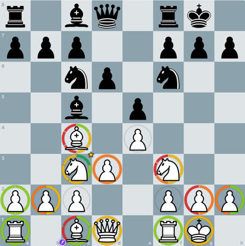
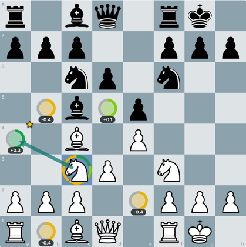
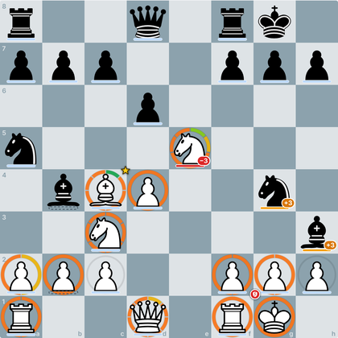
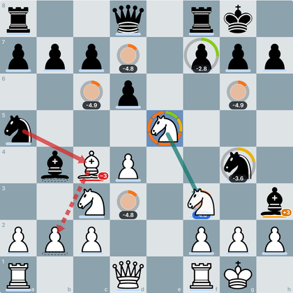
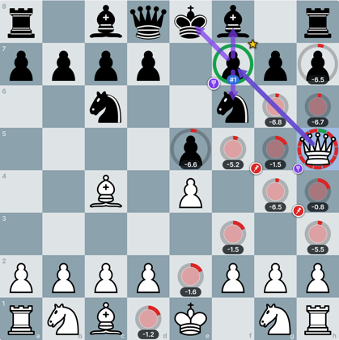
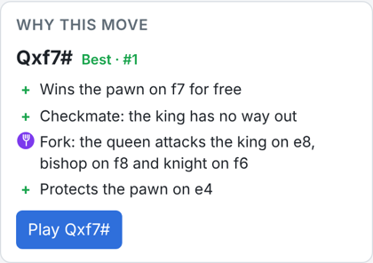
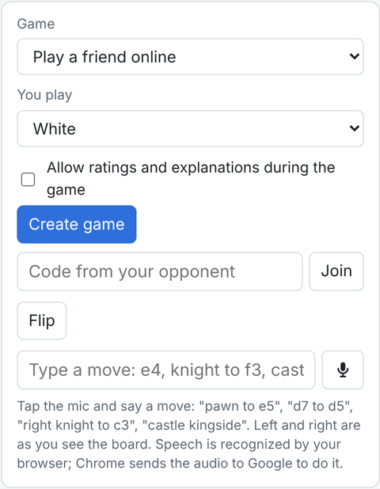

Chess Visuals is a visual chess trainer that runs entirely in the browser. It marks up the board with what you'd want to notice before moving. On your turn, a small ring on each of your pieces rates its legal moves, so you can see which pieces have good options and which only have bad ones before you pick anything up. A bar under every piece, yours and your opponent's, shows whether it's protected, loose or about to be lost, and forks, pins and skewers are flagged where they happen. Select a piece and each square it can move to is rated too, with a short explanation of why.

**[Play it here](https://robertpiazza.com/chess-visuals/)**. The source is at [github.com/robertpiazza/chess-visuals](https://github.com/robertpiazza/chess-visuals).

There is no build step, and the only server is a small Firebase database used when you play a friend online. Everything else is static files on GitHub Pages: about 4,300 lines of JavaScript, a chess rules library, Stockfish compiled to WebAssembly, and 75 tests.

*Updated November 21, 2026: added safety bars under the pieces, online games against a friend, and changes to the mistake preventer.*

<p><a href="/assets/images/chess-visuals/rings.png"></a><a href="/assets/images/chess-visuals/selected-piece.png"></a><br><em>Left: the rings on White's pieces in an Italian-style middlegame. Right: the c3 knight selected, with each target square rated. Click either to enlarge.</em></p>

---

## What you see on the board

**Rings on your pieces.** With nothing selected, each of your pieces gets a pie ring with one slice per legal move. The slices run clockwise from 12 o'clock, best move first. The color is the move's quality: green for Best, lime for Good, yellow for Inaccuracy, orange for Mistake, red for Blunder. A star marks any piece that has at least one Best move, and a faint grey ring means the piece can't move at all.

I wanted to read a position by shape before reading any notation. A knight ringed in mostly red is a piece to leave alone. A bishop with one green slice and a star has a single good idea and several that lose something.

**A selected piece.** Each target square gets a disc tinted by the move's class and an arc filled to your winning chance after the move. The label under it is the engine score in the usual convention: +1.0 means White is about a pawn ahead, #3 means White mates in three. When the move mates, every line wins outright, so a win-percentage arc would be full on all of them. In that case the arc shows speed instead. The fastest mate in the position fills the ring, and mate in n fills fastest/n of it.

A side panel lists the same moves with SAN, class, score and win percentage. Hovering a row highlights the square, and clicking a row plays the move. Promotions bring up a picker with each choice rated.

**Moves already played** are annotated with the rating they had when played (`?!`, `?`, `??`), for you and for the computer.

**Safety bars.** Every piece except the kings, on both sides, has a short bar under it. The bar answers one question: if the opponent started capturing on this square and both sides kept trading while it paid off, who would come out ahead? It shows on either side's turn.

| Bar | Meaning |
|---|---|
| Light blue | Protected, or attacked but the trades come out even or better. |
| Dashed outline | Loose: nothing defends it. It isn't attacked yet. |
| Red, with −n | A piece of the player at the bottom of the board that would lose n pawns' worth. |
| Amber, with +n | A piece of the player at the top that the bottom player can win. |

Red and amber are always from the point of view of whoever is at the bottom of the board, so flipping the board swaps them. The bars are deliberately quiet: a board where every bar is light blue is a board where nothing hangs, and the eye goes straight to the red and amber ones.

While you drag a piece, or hover one of a selected piece's targets, the bars show the position after that move. That shows what a move does to the rest of the board: which of your pieces it leaves undefended, which it protects, and which enemy pieces it starts attacking. A checkbox in settings turns the bars off.

<p><a href="/assets/images/chess-visuals/safety-bars.png"></a><a href="/assets/images/chess-visuals/safety-drag.png"></a><br><em>Left: the knight on e5 loses 3 (the d6 pawn and g4 knight attack it, and only the d4 pawn defends it), while the black knight on g4 and bishop on h3 can be won. Right: dragging the knight to f3. The bishop on c4 loses its only defender and turns red, and the knight now blocks the queen's line to g4, so that +3 goes away.</em></p>

The calculation is a static exchange evaluation, in `safety.js` (about 60 lines). It plays out the captures on the square, each side always using its cheapest piece that can legally take, and works back from the end so either side can stop when going on would cost it. Because each capture is checked for legality, a pinned defender doesn't count, and pieces lined up behind each other (a rook behind a rook, a queen behind a bishop) join in as the pieces in front are traded off. It doesn't look at checks or threats elsewhere on the board, so it is a quick guide rather than a search.

---

## How moves get rated

The rating comes from Stockfish. The app asks it for a score for every legal move, using Stockfish's MultiPV option set to the number of legal moves. Each of those scores is the engine's evaluation of the position after that move, from the side to move's point of view.

A centipawn score is awkward to compare across positions, because 100 centipawns means something different at +0.0 than at +5.0. So each score is converted to a winning chance with the curve Lichess uses:

```
win% = 50 + 50 · (2 / (1 + e^(−0.00368208 · cp)) − 1)
```

The score is clamped to ±1500 centipawns first. A mate score is 100% or 0%.

A move's class comes from how many win-percentage points it gives up compared with the best move:

| Class | Drop vs. best move |
|---|---|
| Best | the engine's top score, or tied with it |
| Good | 6 points or less, but not tied |
| Inaccuracy | 12 or less |
| Mistake | 22 or less |
| Blunder | more than 22 |

"Best" means exactly the top score or a tie with it, nothing looser. That matters in positions where two moves both mate or both hold the same evaluation: both get the star. Sorting uses a key where faster mates rank above slower ones and being mated later ranks above being mated sooner, so mate scores sort sensibly against ordinary ones. All of this lives in `analysis.js`, about 120 lines.

Ratings refine as the search deepens. Stockfish reports a result at each depth, the board redraws on each one, and a "Rating depth" slider sets where it stops. The first rings you see come from a shallow search and get revised as deeper results arrive. If you move before the search finishes, the in-flight analysis is cancelled and the engine starts on the new position.

---

## The two engines

**Stockfish 18 lite** is the single-threaded WebAssembly build, around 7 MB. It runs in a Web Worker so the board stays responsive. The wrapper in `engine.js` speaks UCI to it: send `uci`, wait for `uciok`, send `isready`, then per position send `setoption name MultiPV`, `position fen`, and `go depth`. It parses the `info` lines (depth, multipv index, `score cp` or `score mate`, and the principal variation) and keeps one entry per first move. It ignores bound-only lines, and a `mate 0` line is dropped because it means the side to move is already mated and there are no moves to rate. A new request while one is running sends `stop` and queues the next job, so analyses never overlap.

**A built-in fallback** exists for when Stockfish can't load, for example on a browser without WebAssembly. It is a small alpha-beta search with quiescence, on its own 0x88 move generator, using simplified piece-square tables. It searches to depth 2 to 6, which is much weaker, but it catches hanging pieces and short tactics. It scores every root move too, so the rest of the app doesn't know which engine it's talking to. You can force it with `?engine=builtin` in the URL. Because its search can't be interrupted, cancelling means terminating the worker and starting a new one.

Both sit behind one interface: `engine.analyse(fen, { depth, moveCount }, onUpdate)`.

---

## Explaining the move

A rating says how good a move is but not why. The "Why this move" card tries to supply the why. It combines the engine's numbers with pattern checks in `tactics.js` and `principles.js`, joined in `explain.js`.

The checks are static: they look at the board after the move and describe what it sets up, without searching. The engine rating says whether the idea works.

**Tactics.** The detector finds forks, pins, skewers, discovered attacks and checks, trapped pieces, mate threats, captures and trades, attacks on undefended pawns, and pieces a move leaves hanging. It checks capture legality, so a pinned piece doesn't count as a defender, and it handles en passant. Three of the more specific patterns:

- *Removing the defender*: a capture that leaves another enemy piece hanging, even after the recapture.
- *Overload*: one enemy piece that is the only guard of two pieces you attack.
- *Sound sacrifice*: a move that gives up material, because the piece can be taken or it captures something worth less, yet the engine still rates it Best or Good. The card says whether the engine's line mates, wins the material back, or plays for lasting pressure. A pawn version is labeled a gambit.

**Tactic badges.** Moves that force a tactic get a pictogram badge: a dinner fork for a fork, a push pin for a pin, a skewer, a magnifying glass for a discovery, a birdcage for a trapped piece, a cracked shield for removing the defender, a weight for overload, a flame for a sacrifice. The badge is purple when the tactic works. That requires the move to be rated Best or Good and the engine's line to win at least two pawns of material over the opponent's next few replies, or to mate. A pin counts as soon as it exists. The badge is red when the move creates the pattern but doesn't pay off, because the engine rates the move lower or its line wins nothing. The red case is the useful one: a fork that looks great and fails to a better reply is a move beginners find all the time.

A tactic can also arrive a move late. If the engine's line has a check that drives the king onto a forking square, the move gets the badge even though the fork isn't on the board yet.

**Principles.** `principles.js` covers center control, development, castling and king safety, early queen moves, moving a piece twice, trades when ahead or behind, the bishop pair, open files and the seventh rank, batteries (queen and bishop on a diagonal, queen and rook pairs on a file), pawn breaks, knight outposts, bad bishops, rook placement behind passed pawns, the opposition in king and pawn endings, doubled and isolated pawns, and king activity in the endgame.

**Comparison with the engine's choice.** If your move isn't the engine's top pick, the card says what the preferred move does that yours doesn't, or shows the line where the difference appears. For a move that loses ground it names the opponent's expected reply and what it wins: "Allows Nxg5: wins the queen on g5 for free." A move that develops a piece while making a threat is flagged as gaining a tempo.

### Arrows

The same content is drawn on the board as arrows. Color says what kind of information the arrow carries, and solid versus dashed says whether it is something that happens now or something that follows.

| Arrow | Meaning |
|---|---|
| Teal, solid | The move you are looking at: the selected piece going to the square you are hovering or have clicked in the move list. |
| Purple, solid | A tactic the move creates now: the lines of a fork, pin, skewer, discovered attack or check, a capture that wins material, a threat on a piece. |
| Purple, dashed | A tactic that arrives a move later, in the engine's line after the opponent's best reply. |
| Red, solid | Something that goes wrong. A piece the move leaves hanging, a tactic that is available but doesn't pay off (it matches the red badge), or the opponent's expected reply when your move is a real error. |
| Red, dashed | What the opponent's reply then attacks. |
| Dark grey, solid | A neutral note: a trade, a plain check, a sacrifice the engine still likes, or a positional idea such as a battery or pawn break. |
| Blue, faded | A book move from the openings library, up to five at a time. In practice mode only the next line move is shown. |
| Light grey, faded | The last move played. Once the move has a rating, the arrow takes that rating's color, so a blunder shows in red and a best move in green. It is hidden while a move is being previewed, so it doesn't compete with the preview arrows. |
| Rating color, solid | Under the mistake preventer, the one legal move that avoids a mistake or blunder. |

With nothing selected, red arrows show what the opponent's last move threatens. Arrows are drawn under the score pills, stars and badges, so they never cover a rating.


<p><a href="/assets/images/chess-visuals/mate-arc.png"></a><a href="/assets/images/chess-visuals/why-card.png"></a><br><em>A position with mate on the board. The queen's other moves are all red, Qxf7# gets the star and a #1 label, and the card explains the move.</em></p>

---

## Playing games

**Opponent.** You can play White, Black, or "both sides," where the app rates moves for whoever is to move. A fourth option, "Play a friend online," is covered in its own section below. The computer uses the same ratings you see. At strength 20 it always plays the top move. Below that it picks randomly from moves within an allowed win-percentage loss, weighted toward the better ones:

```js
const allowed = (20 - s) * 1.6;
const temp = 1 + (20 - s) * 0.5;
const pool = moves.filter(m => m.loss <= allowed);
const weights = pool.map(m => Math.exp(-m.loss / temp));
```

Weaker settings also search less deeply. The opponent makes plausible mistakes rather than random ones. With the default strength of 8 the cutoff is 19 points, and a move that drops more than 22 only gets into the pool below strength 6.

**Move tree.** Every move goes into a tree, not a list. Stepping back and playing something different creates a variation. The line you actually played stays the main line, and nothing is deleted. The ‹ › carets and arrow keys step through the game (Home and End jump to the ends), and "forward" follows the branch you were last on. The Moves list shows the main line with variations in parentheses. The tree is 72 lines in `tree.js`. The computer only replies at the end of a line, so you can step back and try moves for either side.

**Engine lines as variations.** "See the line" inserts the engine's expected continuation as a variation and steps into it. After a move that wasn't best, the review card offers "See why Nc6 was better," which inserts the engine's line from the position before your move. These lines are italic with a purple bar and never become the main line. If you play one of their moves yourself, it becomes a real move.

**Typed and spoken moves.** Type a move under the board, or tap the mic and say it. The parser in `voice.js` accepts "e4," "pawn to e5," "d7 to d5," "knight takes f6," "bishop takes knight," "right knight to c3," "queen's rook to d1," "castle kingside," and "e8 queen." Left and right are from your side of the board, so they swap when it's flipped. It maps common mishearings ("night," "see," "for") and NATO letters ("echo four") to the intended tokens. Speech recognition returns several guesses, and the app takes the first one that names a legal move. If a phrase fits more than one move, you pick from buttons. The mic needs the browser's speech recognition API: Chrome, Edge and Safari, not Firefox. In Chrome the audio is sent to Google for recognition.

**Animation.** Clicked and computer moves glide to their square in about 0.2 seconds, captured pieces fade, and the rook slides when castling. Stepping back plays the move backwards. Dragged moves and users with reduced motion enabled skip the animation.

---

## Playing a friend online

Choosing "Play a friend online" in the Game menu swaps the opening picker and New game button for the room setup, in the same box. You pick a side (White, Black or random) and whether ratings and explanations are allowed during the game, then press Create game. You get a six-character room code and a button that copies an invite link. Your friend opens the link, or picks the same option and types the code.

<p></p>

If the host doesn't allow ratings, both players get a plain board while the game is live: no rings, target ratings, safety bars, arrows, explanations, opening card or evaluation bar, and the engine doesn't run. Everything comes back for both players when the game ends, so you can step through it together. If the host allows them, each player's own settings apply.

You can still step back and try moves during the game. Those stay on your board as variations, and End returns to the live position. Only moves played at the live position are sent. Either player can resign. Reloading the page rejoins the same side, because the room code stays in the address bar and the tab remembers which side it holds. A third person who opens the link is turned away.

Moves go through Firebase Realtime Database, in the same project as my 5³ Chess game. A room stores its settings, the moves keyed by ply, and the result. The database rules enforce the shape of the game: room settings can't change once created, only one guest can join, no move can be played before the guest joins or after a resignation, and each move can be written once and never overwritten. The Firebase library is only loaded when you create or join a game, so the rest of the site doesn't depend on it. There is no undo, clock or draw offer.

---

## Openings

`openings.js` holds about 70 named lines (Ruy Lopez, Italian, Najdorf and Dragon Sicilians, French, Caro-Kann, Queen's Gambit, King's Indian, Nimzo-Indian, London, English and others), each with an ECO code and a one-line idea. The Opening card names the current opening and lists the book moves from the position, with the openings each leads to. Book moves also appear as blue arrows.

"Practice an opening" has the computer follow a chosen line while the card shows your next book move. If you leave the line, it says where and what the book move was. Outside practice, the computer picks randomly among book moves while any remain, skipping any the engine rates a Mistake or Blunder, so games start from varied and sound positions.

---

## The mistake preventer

This is a setting that turns the display into a safety check. When it's on, rings, target ratings and hints show only moves rated Mistake or Blunder. You see where the traps are and can hover an orange or red target to read why before you play it. Opening guidance is hidden. If exactly one legal move avoids a Mistake or Blunder, an arrow in its rating color shows it and the status line names it.

Selecting a piece doesn't preview anything on its own while the preventer is on. A mistake's arrows and explanation appear only while you hover its target square or its row in the move list, or after you click the row.

It only filters what is displayed. The ratings and the opponent's strength don't change. It starts off on every page load: the saved-settings code deletes the stored value, so it can't carry over from an earlier session.

---

## Under the hood

The files:

```
web/js/
  main.js        game flow, computer opponent, online games, side panel (~1,250 lines)
  board.js       SVG board, rings, markers, drag and click input
  analysis.js    win%, classes, per-piece summaries
  tactics.js     fork, pin, skewer, discovery, trap, hanging detection
  safety.js      static exchange count behind the safety bars
  principles.js  positional commentary
  explain.js     combines the above with the engine line; badges
  openings.js    opening library and lookup
  voice.js       typed and spoken phrases to legal moves
  tree.js        move tree with variations
  network.js     online rooms and moves in Firebase
  online.js      room codes and move-list helpers
  engine/        Stockfish wrapper, built-in search, 0x88 move generator
```

The board is drawn as SVG, with the cburnett piece set. Move legality, SAN and game state come from chess.js 1.4.0. The tactic code works on its own 64-square arrays, parsed from FEN, so it can apply a move and inspect the result without going through the game object. The engine's built-in search uses a separate 0x88 representation because it needs speed.

There are 75 tests, run with `node --test`. They cover move generation against known node counts (perft), the rating and classification logic, the Stockfish protocol parsing, the move tree, the voice parser, the exchange counts behind the safety bars (including a pinned defender), room codes, and the explanation and tactic detection, which is the largest suite. The online game was also tested end to end in a headless browser, with two players against the real database.

**Deployment.** A push to `main` runs the tests and then publishes `web/` to the `gh-pages` branch with a GitHub Actions workflow. GitHub Pages lets browsers cache files for ten minutes, so a fresh `index.html` could load a stale `main.js`. A small script (`stamp-version.mjs`) runs on a copy of `web/` during the build and appends `?v=<commit>` to every CSS and JS URL, including relative imports between modules and the built-in engine's worker. Vendored code is left alone. That removes the "works after a hard refresh" problem.

---

## What it accomplishes

Most chess tools give you an evaluation bar or a best move after the fact. This one puts the rating on the piece, before you move, and then tries to say why in terms a club player recognizes: a fork, a pin, a hanging piece, a knight outpost.

It has limits. The explanations are pattern checks, so strategic ideas that don't match a pattern get no comment. The in-browser Stockfish is the lite build at modest depth, so a move near a class boundary can change class if you search deeper. Voice input depends on your browser's speech recognition.

The repository has 57 commits between October 29 and November 21.

Try it at [robertpiazza.com/chess-visuals](https://robertpiazza.com/chess-visuals/). Load a position you've been stuck on with "Load position (FEN)" and see which pieces have only red rings, or send a friend an invite link.
