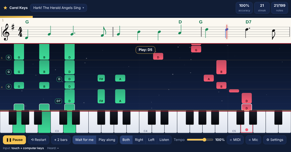
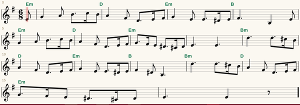
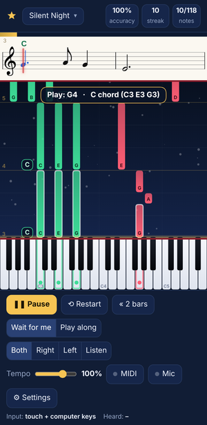

Carol Keys is a piano practice page for Christmas carols. The melody goes in the right hand and the chords in the left. Notes fall toward an on-screen keyboard, the same melody scrolls by on a music staff with the chord names above it, and the page listens to what you play, either from a MIDI keyboard or through the microphone.

**[Play it here](https://robertpiazza.com/piano/)**. The source is at [github.com/robertpiazza/piano](https://github.com/robertpiazza/piano).

It is one HTML file with no server. The app is about 65 KB of JavaScript, plus the VexFlow notation library built into the page so it also works offline.

<p><a href="/assets/images/piano/overview.png"></a><br><em>Hark! The Herald Angels Sing, a few bars in. Click to enlarge.</em></p>

---

## What you see

**Falling notes.** Right-hand notes are red and left-hand notes are green. Each left-hand chord has its name in a small tag beside it (C, G7, Am), so you learn the chord name and the shape at the same time. Notes reach the keyboard at the gold line, and the keys light up as they sound.

**Sheet music.** Above the falling notes, the melody is written on a treble staff with the key signature, time signature and the chord name above each change. A red cursor moves through the music as the song plays. Notes turn blue when they are due, green when you hit them and red when you miss them. Two lines show at a time so you can read ahead, the page turns by itself, and tapping a bar jumps the song there.

I wanted both views because they teach different things. The falling notes tell you which key to press right now. The staff is what you would read from a real songbook, and seeing the two together connects the dots on the page to the keys under your fingers.

**Two ways to practice.**
- *Wait for me* stops the music until you play the right notes, and shows what it is waiting for: "Play: E5 · C chord (C3 E3 G3)".
- *Play along* keeps time and grades each note Perfect, Good or Miss, with an accuracy score and a streak counter.

You can play both hands, either hand alone while the page plays the other one, or just listen. There is a tempo slider, a metronome, a button to go back two bars, and a saved best score for each song, hand and mode. If triads are too much at first, a setting changes the left hand to root and fifth, or to the root note only.

---

## Note recognition

There are three ways to play into it.

**A MIDI keyboard.** This is the accurate option. A digital piano or controller plugged in over USB shows up through the browser's Web MIDI support, and every note and chord arrives exactly. It works in Chrome and Edge on a computer or Android tablet. Safari and iPad browsers don't support Web MIDI.

**The microphone,** for an acoustic piano. This is the harder problem and the recognition is basic. Every animation frame the page takes a 16,384-point FFT of the mic signal, which is fine enough to separate neighboring notes down to the bottom of the left hand. For each note from E2 to C7 it adds up the energy at the note's frequency and its next four harmonics. A note counts when that total stands out from the background and is the largest among its neighbors. A few extra checks stop it reporting notes that aren't being played:
- the note's own frequency (or its octave) has to carry a fair share of the energy, so a high note's harmonics don't show up as a phantom low note;
- a note an octave or a twelfth above one it already heard has to be clearly louder to count separately;
- a new note needs an attack. A second, short analysis window watches for a sudden jump in loudness, so a held note isn't counted again and a repeated note (the E-E-E of Jingle Bells) is.

The page also knows which notes the song expects next, and it accepts those on weaker evidence than a note it isn't expecting. I tested this with synthesized piano-like tones rather than a real piano. Single notes and repeated notes came through cleanly. In chords it sometimes reported an extra note an octave or more up, or missed the top note. Headphones help so it doesn't hear its own accompaniment, and an "Accept any octave" setting covers low notes that get read an octave off.

**Touch or a computer keyboard.** You can tap the on-screen keys, or use two rows of the computer keyboard: Z through / for the left hand (G2 to B3) and Q through ] for the right (C4 to G5).

---

## The song library

There are 18 songs, all public domain:

Jingle Bells (an easy chorus version and the full song), Silent Night, Joy to the World, Deck the Halls, We Wish You a Merry Christmas, Hark! The Herald Angels Sing, O Come All Ye Faithful, The First Noel, O Little Town of Bethlehem, Away in a Manger, Angels We Have Heard on High, God Rest Ye Merry Gentlemen, What Child Is This?, We Three Kings, It Came Upon the Midnight Clear, O Come O Come Emmanuel, and Good King Wenceslas.

Popular modern songs like "Rudolph" and "All I Want for Christmas Is You" are still under copyright, so they aren't included. You can load any MIDI file you have, though, and the page splits it into hands: if the file has two parts, the higher one becomes the right hand; otherwise notes from middle C up go to the right hand.

**Getting the notes right.** The first version had seven songs written out by hand. Several well-known carols were left out because I couldn't be sure of every note. A song you're learning has to be exactly right, or you end up practicing a mistake.

For the rest I used two collections of public-domain hymnal scores on GitHub, written in LilyPond (a text format for engraved music): Musicam Ecclesiae's [English Hymns](https://github.com/magdalenesacredmusic/English-Hymns) and Ben Kuhn's [carols](https://github.com/benkuhn/carols). A hymnal score has four voice parts (soprano, alto, tenor and bass), and the soprano part is the tune everyone knows.

I wrote a small LilyPond reader, about 135 lines, that handles the parts these scores use: relative pitches, durations, dots, ties, pickup bars, key and time signatures. To check it, I compared its output with the MIDI files the collection had already generated from the same scores. For the ten carols that had MIDI files, every melody note matched in pitch and timing. (One MIDI file was in a different key from its score, so that comparison allowed for the shift.)

**Chords from the harmony.** The left-hand chords come from all four voices, not from my guesses. For each half bar (each bar in 3/4 and 6/8), the converter totals how long each pitch sounds and scores every major, minor, dominant seventh and diminished chord against it. The chord gets a bonus if the bass note is its root and if the melody note at that moment is in the chord. It also gets a preference for the common chords of the key, so a beginner sees G, C and D7 rather than an occasional F#m. A final check lists every place where a melody note on the beat isn't in the chord under it. I went through those by hand and changed the chord where the clash would sound wrong.

The same sources let me check the original seven songs. Joy to the World, Deck the Halls, We Wish You a Merry Christmas and Good King Wenceslas matched note for note. Silent Night had one difference: the second "sleep in heavenly peace" uses even quarter notes in Gruber's hymnal version, not the dotted rhythm many people sing, so I changed it to match the source.

Some songs were moved to easier keys. The First Noel is in C; Away in a Manger, Angels We Have Heard on High and It Came Upon the Midnight Clear are in G. We Three Kings is written in 3/4 instead of 3/8, and It Came Upon the Midnight Clear in 3/4 instead of 6/4, so they read more easily.

<p><a href="/assets/images/piano/sheet-music.png"></a><a href="/assets/images/piano/phone.png"></a><br><em>Left: What Child Is This? in 6/8, with the chords derived from the hymn's four-part harmony. Right: the phone layout. Click either to enlarge.</em></p>

**Writing your own.** A built-in editor takes a simple text format, one token per note:

```
title: Ode to Joy
bpm: 100
time: 4/4
key: C
right: E4:1 E4 F4 G4 | G4 F4 E4 D4 | C4 C4 D4 E4 | E4:1.5 D4:.5 D4:2
left: C | G:2 C:2 | F:2 C:2 | G
```

`E4:1` is E above middle C for one beat. The left hand can use chord names, and a chord with no length lasts one bar. The `|` bar lines are checked, so a bar with too many or too few beats shows an error. Songs you add are saved in your browser.

---

## Drawing the sheet music

The staff is drawn with [VexFlow](https://github.com/0xfe/vexflow), an open-source music engraving library. VexFlow draws notes; deciding what to draw is up to the app. The songs are stored as notes with lengths in beats, so the page has to turn that into notation:
- fill gaps with rests;
- split any note that crosses a bar line and tie the pieces together, including across a line break;
- break each length into note values you can write (a five-beat note in 3/4 becomes a dotted half tied to a half);
- spell each note for the key, so the same black key reads F# in G major and Bb in F major, and let VexFlow add accidentals and beam the eighth notes;
- fit bars to the screen width, two bars per line on a phone and four or five on a laptop.

The cursor position comes from the drawn notes. After drawing, the page records the x position of every note against its beat and slides the cursor between those points as the song plays. Tapping a bar runs the same lookup in reverse to find the beat to jump to.

---

## Testing and deployment

The tests run with `node --test`. They check every song in the library (each bar has the right number of beats and both hands are the same length), the chord and note parsers, key spelling, the text format, and the MIDI file reader. A separate browser test plays every song from start to finish in *Wait for me* mode, feeding in the expected notes; all 18 finish with every note hit.

A push to `main` runs the tests, builds the page with VexFlow built in, and publishes it to the `gh-pages` branch with GitHub Actions, the same setup as [Chess Visuals]().

---

## Limits

Microphone recognition is the weak point. It is reliable for a single melody line, less so for full chords on an acoustic piano, and it struggles in a noisy room. A MIDI keyboard avoids all of that. The library has no source yet for O Christmas Tree, Up on the Housetop, Jolly Old Saint Nicholas, O Holy Night or The Twelve Days of Christmas, so they aren't in it.

Try it at [robertpiazza.com/piano](https://robertpiazza.com/piano/). Start with the easy Jingle Bells chorus in *Wait for me*, right hand only, then add the left hand.
